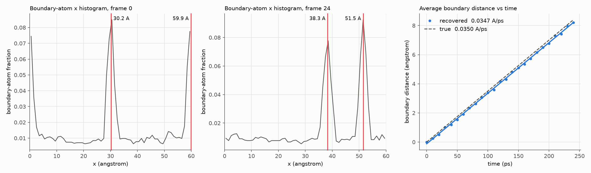
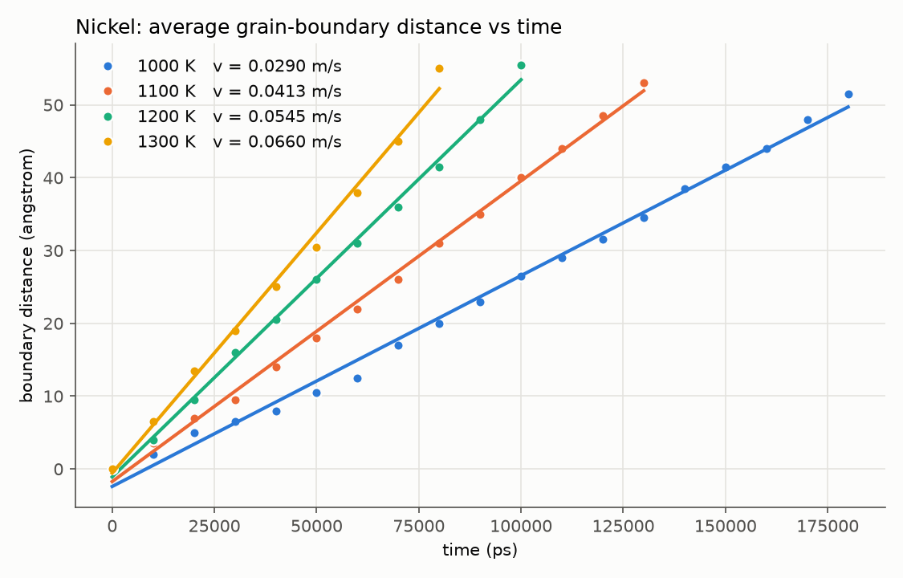
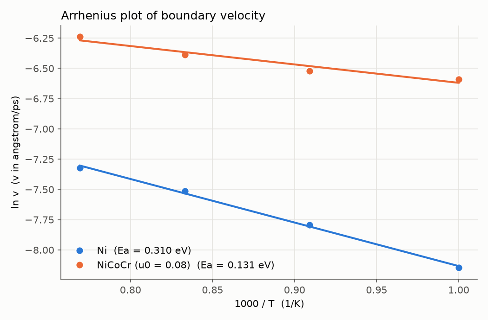
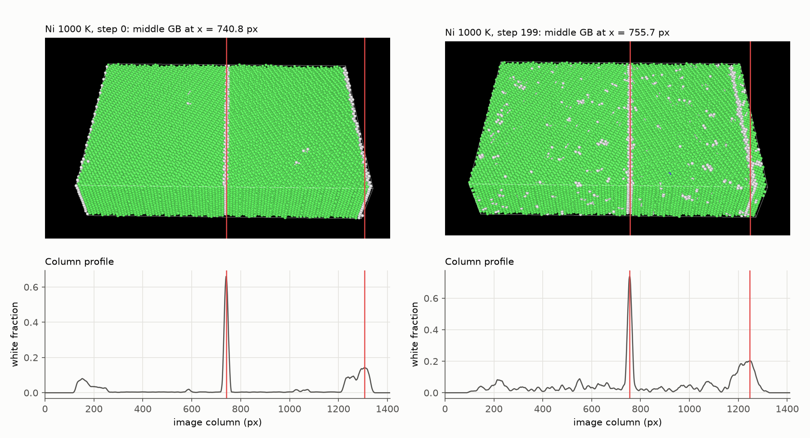

# Grain Boundary Velocity Tracker

Measures how fast a grain boundary moves in an atomistic simulation, straight from the LAMMPS dump file that OVITO reads, and turns a set of runs at different temperatures into a velocity table and an Arrhenius fit.

I wrote the original version of this as a research assistant in the Rupert Lab at UC Irvine, where I ran hybrid Monte Carlo / molecular dynamics simulations (LAMMPS) of a NiCoCr bicrystal to see how alloying and chemical ordering change how easily a grain boundary moves. The original scripts were lost when my lab account closed; this repository is a rebuild of that tool from the study's data and notes.



## What it replaced

Each simulation produces a trajectory of 200 frames. The number we wanted from every run is one slope: how far the boundary moved against how much time passed.

The manual way to get it, which is how I did it at first, was to open the trajectory in OVITO, step forward a fixed number of frames, measure the boundary's new position with OVITO's measuring tool, write the distance down in a spreadsheet, and repeat about twenty times per run. Then fit a line. It took about an hour per run and had to be done again for every temperature and every alloy.

This tool does the same measurement automatically: it reads the trajectory, finds the boundary in every Nth frame, records its position in angstrom and fits the line. A 40-frame trajectory runs in under three seconds, so adding a temperature or re-running a condition stopped being a planning decision.

## How it works

1. **Reads the LAMMPS dump that OVITO reads.** No export step and no screenshots. The LAMMPS run already writes a per-atom structure type from polyhedral template matching (`v_ptm_type`); atoms that are not FCC are, by definition, the grain boundary, which is exactly what OVITO renders white. If that column is missing the tracker falls back to centrosymmetry (`c_csym`), and if neither exists it says which column to add to the dump command.
2. **Finds the boundaries.** Boundary atoms are binned along the migration axis. A grain boundary is a coherent plane, so it shows up as a sharp peak in that histogram, while thermal disorder at high temperature only raises the background. Two peaks are tracked: the boundary in the middle of the bicrystal and the one at the periodic edge of the box.
3. **Tracks and fits.** Each boundary is followed frame to frame with periodic unwrapping, so crossing the box edge does not break the distance. Distance against time is fit by least squares for the velocity in angstrom/ps (1 angstrom/ps = 100 m/s). Across temperatures, `gbtrack arrhenius` fits ln(v) against 1/T for the activation energy.

```
gbtrack run mcmd.sro.dmp.gz --every 10 --dt-ps 0.002 --out results/1000K
gbtrack arrhenius velocities.csv --out results
```

## Results from the original study

The data below are the spreadsheet numbers from the 2024-25 study, re-fit with this tool.



| Alloy | 1000 K | 1100 K | 1200 K | 1300 K |
|---|---|---|---|---|
| Pure nickel | 0.029 m/s | 0.041 m/s | 0.055 m/s | 0.066 m/s |
| NiCoCr, random solid solution | 0.137 m/s | 0.147 m/s | 0.169 m/s | 0.195 m/s |

Alloying sped the boundary up by about 4.7x at 1000 K. The Arrhenius fit gives an activation energy of 0.31 eV for nickel and 0.13 eV for the random NiCoCr alloy; in the full study, chemically ordered NiCoCr raised that barrier roughly threefold over the random alloy.



## It also works on the pictures

When only OVITO renders are available, `gbtrack images` runs the same peak-finding on the image: whitish pixels are the boundary, a column profile replaces the atom histogram, and a scale in angstrom per pixel converts the displacement. The frames below are the real 1000 K nickel run at step 0 and step 199 with the detected boundaries marked. Even at 1400 K, where thermal disorder covers the sample in white specks, the boundary's columns sit around 0.75 white against a background of about 0.2.



## Validation

Synthetic trajectories with a known boundary velocity and a controllable amount of thermal noise are generated by `gbtrack demo`. The tracker recovers the velocity within 1% on the dump path (0.0347 vs 0.0350 angstrom/ps with 10% noise atoms, including a boundary that crosses the periodic edge) and within 0.1% on the image path. The test suite (61 tests, pytest) covers the dump parser, boundary selection, peak finding including a boundary straddling the periodic edge, tracking with unwrapping, the velocity and Arrhenius fits against the study's recorded numbers, and the real OVITO frames.

The original dump files did not survive, so the dump path is validated on synthetic trajectories and the study's recorded distances; the image path is validated on the study's real renders.

## Stack

Python, NumPy, Pillow, matplotlib, pytest. Input: LAMMPS dump trajectories (plain or gzip), the format OVITO loads for these runs.
